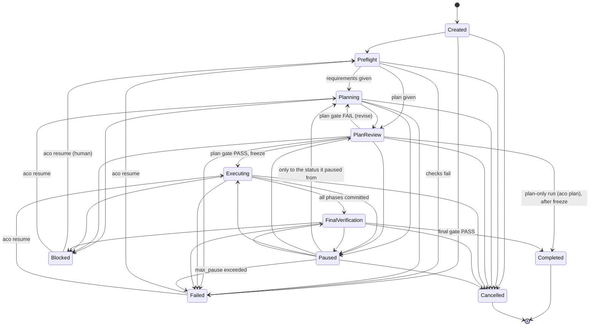
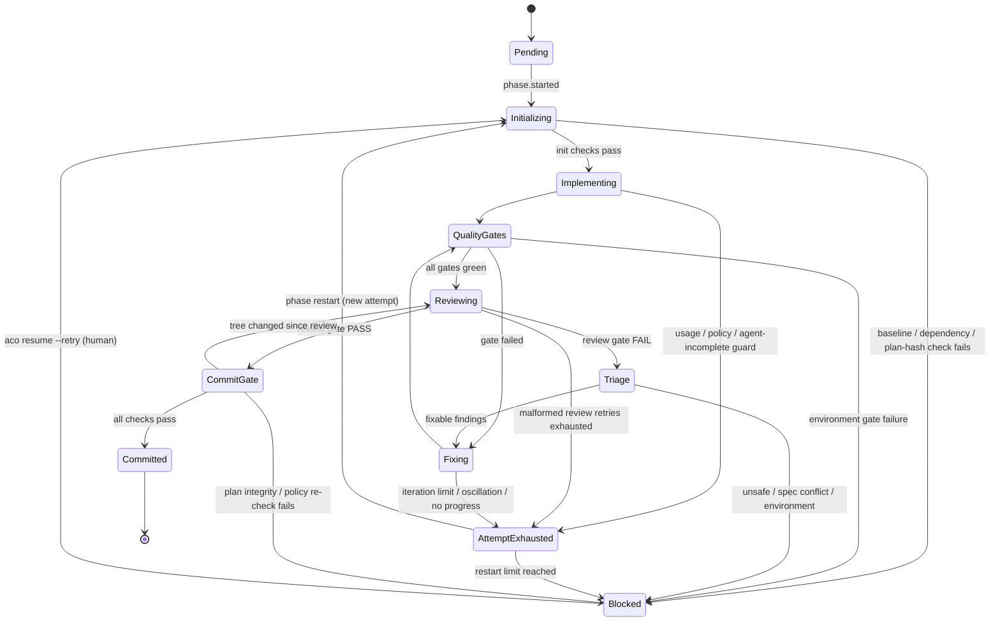

# Run lifecycle, state store, events, and artifacts

Phase 3 adds the durable state under every stage:

| Package | What it does |
|---|---|
| `internal/state` | SQLite database (pure Go `modernc.org/sqlite`, WAL), migrations, the run and phase state machines, the intent/outcome step log, record tables, and the per-repository run lock |
| `internal/events` | The v1 event types (§13), typed payloads, JSON encoding (`schemas/event.schema.json`), operator-language messages, and a pub/sub bus that replays from any `seq` |
| `internal/artifacts` | The run directory: atomic, masked, path-confined writes |

The engine (Phase 9) and resume (Phase 10) build on these; nothing in Phase 3 calls an agent or Git.

## State machines

Both machines are pure functions in `internal/state/machine.go`. The store applies **every** status change through
them, in one transaction that also records stage entries and appends the matching events. An illegal transition
returns an error wrapping `ErrIllegalTransition` (`*TransitionError` names the machine, from, and to) and changes
nothing.

### Run



Compared with the abridged diagram in §13 of the implementation plan, the table adds what the stage descriptions
already require:

- **Blocked from every stage**, including Planning (`plan_invalid`: the planner cannot produce a plan package that
  parses after its retries).
- **Failed from every active status**: an auth, quota, budget, environment, or internal error can happen in any stage
  (§14.1), and a paused run fails when `limits.max_pause` is exceeded.
- **Cancelled from every non-terminal status** (`aco cancel` works at any time).
- **Plan review → Completed** ends a plan-only run (`aco plan`, mode `plan_only`) after the freeze (Phase 8).
- **Paused resumes only to the status it paused from** (`paused_from` is stored).
- **Resume from Blocked or Failed** is a separate operation (`ResumeRun`, used by `aco resume` in Phase 10), not a
  normal transition. The default target is the stage in the stored reason; any stage or preflight may be chosen
  (`--revise-plan` → planning, `--from-phase` → executing). Completed and Cancelled are final.

`Terminal()` is true for completed, blocked, failed, and cancelled: no automatic transition leaves them.

### Phase



The edges added to §11.2 (attempt-ending guards while implementing or reviewing, an environment gate failure, a
commit-gate block) come from §11.7, §11.8, and §14.1. Phases change only while the run is `executing`. Entering
`initializing` always starts a new attempt (`attempts` row); the previous active attempt is marked `exhausted`, and
the final attempt `committed` or `blocked`. The phase engine (Phase 9, [phase-loop.md](phase-loop.md)) only uses these
edges; where there is no direct one it takes the legal path (for example `quality_gates → fixing → attempt_exhausted`
or `reviewing → triage → blocked`).

### Blocked and failed reasons

`blocked` and `failed` are different terminal states. Each stores a `Reason`:

| Field | Meaning |
|---|---|
| `class` | Machine-readable cause; the allowed classes differ between blocked and failed (no class is in both lists) |
| `stage` | `preflight`, `planning`, `plan_review`, `execution`, or `final_verification` |
| `phase` | The phase number; required when blocked in `execution`, not allowed outside it |
| `detail` | English text for the report (masked before it is stored) |

Blocked classes (a human must decide): `init_check_failed`, `plan_integrity`, `plan_invalid`, `plan_review_rounds`,
`spec_conflict`, `unsafe`, `environment`, `iteration_limit`, `oscillation`, `no_progress`, `dispute_deadlock`,
`policy_violations`, `phase_usage_limit`, `final_fix_rounds`, `commit_gate_blocked`. A run cannot be blocked at
preflight.

Failed classes (a system problem): `preflight_failed`, `system_environment`, `internal`, `usage_limit_exceeded`,
`budget_exceeded`, `auth`, `api_quota`, `max_pause_exceeded`, `run_timeout`.

## State store

`state.Open(ctx, path, Options{Redactor, Lang, Now, BusyTimeout})` opens or creates the database and applies the
embedded migrations (`internal/state/migrations/NNNN_name.sql`, numbered 1..n, applied once in a transaction). A
database written by a newer ACO is refused (`ErrNewerSchema`).

Connection settings: `journal_mode=WAL`, `synchronous=FULL` (an intent is durable before the step acts),
`foreign_keys=ON`, `busy_timeout` (default 10 s), and immediate write transactions, so several processes can share one
file and writers wait instead of failing.

| Table | Rows |
|---|---|
| `runs` | One per run: repository key and path, base and run branch, mode (`full`/`plan_only`), input (`requirements`/`plan`), status, `paused_from`, `resume_at`, reason, plan hash, current phase, last event `seq` |
| `stages` | One per entry into a stage (plan review is entered once per round): `active`, `completed`, `blocked`, `failed`, `cancelled` |
| `plan_reviews` | Stage 2 rounds: reviewer verdict (recorded, not trusted), gate result, review JSON |
| `phases` | Frozen-plan phases of the run: status, attempts, base and commit SHA, block reason |
| `attempts` | Phase attempts: `active`, `exhausted`, `committed`, `blocked`; Claude session ID |
| `steps` | The intent/outcome log (below) |
| `invocations` | Claude Code / Codex CLI calls: role, model, auth mode, session, turns, tokens, USD cost, transcript artifact |
| `gate_results` | Quality gate runs per round (and baselines): status, command, exit code, duration, tree hash, summary JSON |
| `reviews` | Code reviews per round and the final review: verdict, gate result, reviewed tree hash, review JSON |
| `findings` | The finding ledger (plan `PF-NNN` and code `F-NN-NNN`): severity, category, resolution class, status, fingerprint, reopen and dispute counts |
| `commits` | Commits ACO made: kind (`plan_freeze`, `phase`, `final_fix`, `final_report`), tree and reviewed tree, tag |
| `reports` | Written reports (phase, blocked, failure, final) with their SHA-256 |
| `events` | The event log, primary key `(run_id, seq)` |
| `locks` | One row per locked repository |

Times are stored as Unix milliseconds (UTC). JSON documents are passed as bytes the caller marshalled from a typed
value; the store checks they are valid JSON and masks them.

### Intent/outcome steps (§14.2)

```go
st, err := store.BeginStep(ctx, state.StepIntent{RunID: id, Phase: 3, Attempt: 1, Kind: "implement",
    Key: "P03/a1/implement", Owner: lock.Owner(), Intent: intentJSON, CheckpointRef: ref})
// ... act ...
store.CompleteStep(ctx, st.ID, outcomeJSON) // or FailStep
```

- `BeginStep` commits the intent (and `step.started`) before returning; act only after it returns nil.
- `Key` is unique per run: repeating it returns the stored step and `ErrStepExists` (idempotent retries).
- A step stays `started` if its process dies. After taking the run lock, resume calls
  `MarkInterrupted(ctx, runID, lock.Owner())`: every `started` step of another owner becomes `needs_reconciliation`.
  Resume then compares the worktree with the step's checkpoint and calls `ResolveStep` with `redone`, `resumed`,
  `accepted`, or `abandoned` (status `reconciled`).
- Completing or failing a step that is not `started` returns `ErrStepState`.

### Run lock

One active run per repository. The key is the canonical repository path (`RepoKey`: absolute, symbolic links
resolved, slash-separated, case-folded on Windows and macOS), so two spellings of one repository share a lock.

| Call | Behaviour |
|---|---|
| `AcquireLock(ctx, repo, runID, ttl)` | Takes the lock. A live holder (heartbeat within its TTL, default 30 s) → `*LockedError` (matches `ErrLocked`) naming its run, PID, host, and last heartbeat. A stale holder (crashed or killed) is taken over; the previous holder is returned so the caller can report it and reconcile its steps |
| `Lock.KeepAlive(ctx, interval)` | Heartbeats every `TTL/3`; reports `ErrLockLost` when another process took the lock over |
| `Lock.Heartbeat`, `Lock.Release` | Fail with `ErrLockLost` if this holder no longer has the lock |

The lock lives in the state database, so it covers every process that uses the same state directory.

## Events

Event types are the closed list in §13 (`events.All`, 56 types); `events.Known` rejects anything else. Encoded form
(`schemas/event.schema.json`):

```json
{"schema":"aco.event/v1","run_id":"20261109-1a2b3c4d","seq":42,"type":"phase.blocked",
 "time":"2026-11-09T10:15:00.123Z","stage":"execution","phase":3,
 "payload":{"from":"triage","to":"blocked","attempt":2,"class":"unsafe","detail":"..."},
 "message":"开发阶段已阻塞"}
```

- `seq` is assigned in the append transaction (`runs.last_event_seq + 1`): it starts at 1 per run and has no gaps.
- `payload` holds only typed fields built with `events.Str`, `Int`, `Bool`, `Strs` (lower-snake-case keys, unique);
  nothing is serialized by reflection. Strings are masked before they are stored.
- `message` is the operator-language text (`zh-CN` by default, from the i18n catalog); payload fields are the
  machine data.

Events the store emits itself:

| Change | Events |
|---|---|
| `CreateRun` | `run.created` |
| preflight → planning / plan_review | `run.preflight.passed`, `run.stage.started` |
| preflight → failed | `run.preflight.failed`, `run.failed` |
| stage → next stage | `run.stage.completed`, `run.stage.started` |
| → paused / paused → stage | `run.paused` (with `resume_at`) / `run.resumed` |
| → completed / blocked / failed / cancelled | `run.stage.completed` + `run.completed`, or `run.blocked` / `run.failed` (with the reason) / `run.cancelled` |
| `ResumeRun` | `run.resumed`, `run.stage.started` |
| pending → initializing | `phase.started`, `phase.attempt.started` |
| restart or `ResumePhase` | `phase.attempt.started` |
| initializing → implementing / blocked | `phase.init.passed` / `phase.init.failed` + `phase.blocked` |
| → attempt_exhausted / committed / blocked | `phase.attempt.exhausted` / `phase.completed` / `phase.blocked` |
| `BeginStep` / `CompleteStep`, `FailStep`, `ResolveStep` | `step.started` / `step.completed` (with `status`) |

Other events (`plan.*`, `gate.*`, `review.*`, `finding.*`, `usage.*`, `agent.invocation.*`, ...) are published by
the later phases with `Bus.Publish`.

### Pub/sub with replay

```go
bus := events.NewBus(store)
sub, _ := bus.Subscribe(ctx, runID, fromSeq) // 0 or 1 = from the beginning
for e := range sub.C { ... }                  // closed when ctx ends; sub.Err() says why
```

A subscriber reads from the database, not from an in-memory queue: it receives every event with `seq >= fromSeq` in
order, without gaps or duplicates, however late it joins or slowly it reads. Appends in this process wake it at once;
appends by another process (another `aco` sharing the database) are picked up by polling (default every second). SSE
`Last-Event-ID` replay (Phase 13) maps directly onto `fromSeq`.

## Artifacts

`artifacts.New(root, redactor).Run(runID)` returns `<root>/runs/<run-id>/`:

```
schemas/<name>.schema.json                 schemas handed to the agent CLIs
planning/round-RR/<file>                   Stage 1 prompts, transcripts, plan drafts
plan-review/round-RR/<file>                Stage 2 context packs, reviews, transcripts
phases/PNN/aK/baseline/<file>              baseline gate logs of attempt K
phases/PNN/aK/steps/sSSSS-<kind>/<file>    per-step prompts, transcripts, reports
phases/PNN/aK/gates/rRR/<gate>.log         gate logs of round RR
phases/PNN/aK/reviews/rRR/<file>           review context, result, transcript
phases/PNN/aK/diffs/rRR/<file>             full.patch, incremental.patch, stat.txt
final/<file>                               Stage 4 logs and review
reports/<file>                             Blocked / Failure Reports
```

The helpers in `layout.go` (`Planning`, `PlanReview`, `Attempt`, `Baseline`, `StepFile`, `GateLog`, `ReviewFile`,
`DiffFile`, `Final`, `ReportFile`, `SchemaFile`) build these paths.

- **Atomic:** `Write` writes a temporary file in the target directory, syncs it, sets mode `0600`, and renames it
  over the target (directories are `0700`). A reader sees the old or the new artifact, never a partial one.
  `Create` returns a `Writer` that buffers a streamed artifact (a transcript) and stores it on `Commit`.
- **Masked:** content is masked with the run's `secure.Redactor` before it is written (registered secrets in raw,
  quoted, JSON-escaped, and URL-escaped form, plus credential patterns). The `Writer` masks the whole content at once,
  so a secret split across writes is still masked.
- **Confined:** paths are relative, slash-separated, at most 16 segments of `[A-Za-z0-9_.-]` (no leading `.` or `-`,
  no `..`, no Windows device names). No component of the run directory or the path may be a symbolic link, junction,
  or other reparse point; such paths are refused (`ErrNotRegular`) for writes and reads.
- Artifacts are limited to 64 MiB (`ErrTooLarge`); producers trim large logs first.

## Tests

- `internal/state/machine_test.go`: every (from, to) pair of both machines against independently written tables,
  Planning ↔ PlanReview loops, Blocked from every stage, reason rules, resume rules, and the events of each transition.
- `internal/state/lock_test.go`: lock contention between real processes (the test binary re-runs itself as a helper),
  stale takeover after the holder is killed, and the kill test: a process killed between intent and outcome leaves a
  `started` step that `MarkInterrupted` turns into `needs_reconciliation`. These are skipped with `-short`.
- `internal/events/events_test.go`: late subscribers from several `seq` values, concurrent publishers, events from
  another process, encoding round trip, the schema enum, and messages for every type.
- Leak tests write `securetest.All` into every database column, every event field, and artifacts, and check the
  stored and encoded output with `AssertNoLeak`.
- `go test -tags=integration ./internal/events/...` runs a whole run through the store, bus, and artifact store.
